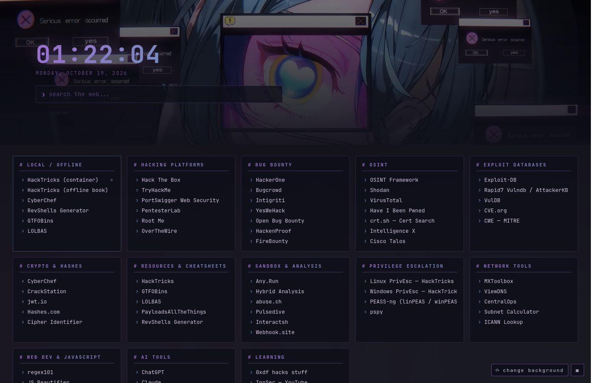

# firefox-startpage



A cyberpunk-themed Firefox new tab page. No extensions required — uses Firefox AutoConfig to load a local HTML file.

**Features:**
- Live clock and date
- DuckDuckGo search bar
- Link cards: hacking platforms, bug bounty, OSINT, exploit databases, crypto tools, cheatsheets, and more
- Purple/blue gradient palette derived from the wallpaper
- Monospace font stack (JetBrains Mono / Fira Code / Cascadia Code)

## Install

### 1. Place the startpage files

```sh
mkdir -p ~/.local/share/firefox-startpage/assets
cp index.html ~/.local/share/firefox-startpage/
cp assets/wallpaper.png ~/.local/share/firefox-startpage/assets/
```

To use a different wallpaper, replace `assets/wallpaper.png` with your own image (same filename), or edit the `background: url(...)` line in `index.html`.

### 2. Find your Firefox install directory

```sh
which firefox          # e.g. /usr/bin/firefox → install dir is /usr/lib/firefox
# or for Firefox ESR:
which firefox-esr
ls /opt/firefox-esr/   # if manually installed
```

### 3. Install the AutoConfig files

Replace `YOUR_FIREFOX_DIR` with your actual path and `YOUR_USERNAME` with your Linux username.

```sh
# Edit mozilla.cfg — replace YOUR_USERNAME with your actual username
nano mozilla.cfg

# Then copy both files:
sudo cp autoconfig.js YOUR_FIREFOX_DIR/defaults/pref/autoconfig.js
sudo cp mozilla.cfg YOUR_FIREFOX_DIR/mozilla.cfg
```

The path to update in `mozilla.cfg`:
```
file:///home/YOUR_USERNAME/.local/share/firefox-startpage/index.html
```

### 4. Restart Firefox

Fully quit Firefox (all windows/processes, not just close-window) and relaunch. New tabs should now open the startpage.

**Troubleshooting:**
- Verify the path in `mozilla.cfg` matches where you placed `index.html`
- Make sure both AutoConfig files are in the right Firefox directory
- Firefox ESR and standard Firefox have separate install dirs — edit the right one
- **Standard release Firefox sandboxes AutoConfig by default**, which silently no-ops the `ChromeUtils.importESModule(...)` line in `mozilla.cfg` (no error shown). `autoconfig.js` already sets `pref("general.config.sandbox_enabled", false);` to disable that — if new tabs still show the default page, confirm this pref actually landed in the installed `autoconfig.js`.
- **Check for a conflicting extension.** Any extension with `chrome_url_overrides.newtab` in its manifest (e.g. another new-tab-replacement addon) silently overrides AutoConfig. Check `about:addons` → Extensions and disable/remove anything else controlling the new tab page.

### Optional: Set as homepage too

`browser.startup.homepage` only affects the Home button and new windows — it does **not** control what loads when Firefox first launches (that's `browser.startup.page`, usually defaulting to "resume previous session"). To also show the startpage on launch, add both lines to `~/.mozilla/firefox/YOUR_PROFILE/user.js`:

```js
user_pref("browser.startup.homepage", "file:///home/YOUR_USERNAME/.local/share/firefox-startpage/index.html");
user_pref("browser.startup.page", 1);
```

This replaces session-resume behavior on launch (old tabs are still recoverable via History → Restore Previous Session). Put changes in `user.js`, not `prefs.js` — Firefox overwrites `prefs.js` from memory on exit, so direct edits there get silently reverted.

## Wallpaper

The wallpaper (`assets/wallpaper.png`) is **not my creation**. I do not know the original artist. If you are the creator and would like it removed or credited properly, please open an issue or contact me and I will make the change immediately.

## Notes

- **Package updates**: `mozilla.cfg` lives in the Firefox install dir and may be overwritten by major upgrades. Re-copy it after updates.
- **Multiple profiles**: The AutoConfig applies to all profiles in that Firefox install.
- **Customizing links**: Edit the cards directly in `index.html` — each `.card` block is self-contained.
- **Colors**: CSS variables are at the top of the `<style>` block in `index.html`.

## File Structure

```
firefox-startpage/
├── index.html          # The startpage
├── assets/
│   └── wallpaper.png   # Background image (swap freely)
├── autoconfig.js       # Tells Firefox to load mozilla.cfg
└── mozilla.cfg         # Redirects new tab to the local HTML file
```
