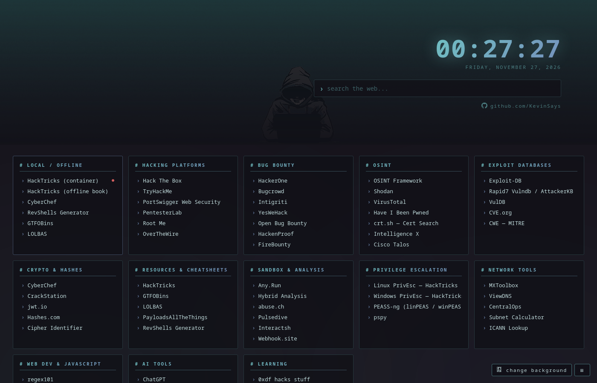
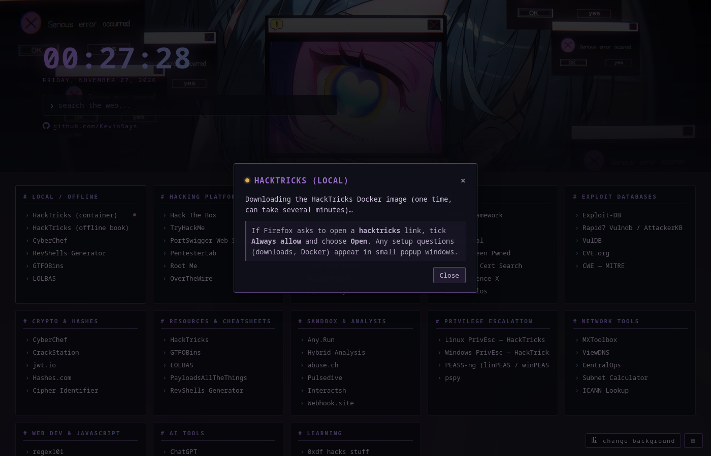
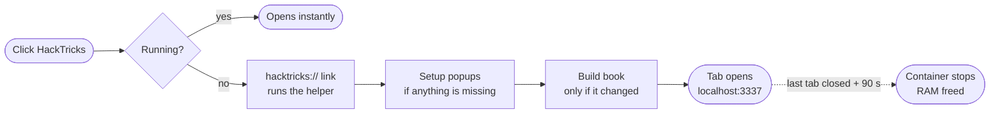

<div align="center">

# ▓▒░ KevinsNighttab ░▒▓

**A cyberpunk new tab page for Firefox, built for hackers.**<br>
Live clock · search · 60+ curated security links · themed backgrounds · offline tools · one-click local HackTricks

<br>




</div>

---

## Quick start

```sh
git clone https://github.com/KevinSays/KevinsNighttab.git && cd KevinsNighttab

mkdir -p ~/.local/share/firefox-startpage
cp -r index.html Background update-backgrounds.py update-local-tools.sh ~/.local/share/firefox-startpage/

sudo ./install-newtab.sh        # new tabs + homepage + launch page → the startpage
```

Quit Firefox completely (**Ctrl+Q**), reopen it, and press **Ctrl+T**.

> Want new tabs only and keep session restore? `sudo ./install-newtab.sh --newtab-only`.
> Undo everything with `sudo ./install-newtab.sh --undo`. Step-by-step guide with checks: **[INSTALL.md](INSTALL.md)**

---

## Features

| | |
|---|---|
| **Clock & search** | Big live clock and date, DuckDuckGo search bar focused and ready to type |
| **Curated link cards** | Hacking platforms, bug bounty, OSINT, exploit DBs, crypto & hashes, sandboxes, privesc, network tools, web dev, AI, learning |
| **Themed backgrounds** | Drop an image in `Background/` and it gets its own palette, dimming, focal point and layout, generated from the image itself |
| **Background picker** | **⟳ change background**, a thumbnail picker, and an optional shuffle on each load. New images show up without a reload |
| **Offline tools** | Local copies of CyberChef, RevShells, GTFOBins and LOLBAS. They work with no internet |
| **One-click HackTricks** | Click it and a local HackTricks starts in Docker. It shuts itself down when you close the tab |
| **No extension** | Uses Firefox's built-in AutoConfig. Nothing to install from the add-on store, and it works for every profile |

---

## One-click local HackTricks

<div align="center">

</div>

<br>

Install the helper once (no sudo):

```sh
./install-hacktricks.sh
```

Then just click **HackTricks (container)** on the startpage. New user with nothing set up? Popups walk you through it,
asking before each step: downloading HackTricks (~350 MB), installing and starting Docker, joining the `docker` group,
and pulling the image.



- **Light.** About **20 MB of RAM** while running, instead of ~4.5 GB for `mdbook serve`.
- **Stops itself.** It shuts down ~90 s after your last HackTricks tab closes. Open tabs keep it alive, even in the background.
- **Fast restarts.** A few seconds, unless HackTricks changed upstream (then it rebuilds, about a minute).
- **Local only.** It listens on `127.0.0.1`, not your Wi-Fi.

From a terminal: `hacktricks` (re)starts it, `docker stop hacktricks` stops it, and `HT_IDLE=300 hacktricks` changes the idle timeout (`0` = never stop).

---

## Backgrounds

Drop any `.png` `.jpg` `.webp` `.gif` `.bmp` `.avif` into `~/.local/share/firefox-startpage/Background/`, then run:

```sh
~/.local/share/firefox-startpage/update-backgrounds.py     # needs Python 3 + Pillow
```

Each image gets its own theme in `Background/backgrounds.js`, with thumbnails in `Background/.thumbs/`. Force one with a URL hash,
e.g. `index.html#bg=LoneHacker.png`. With no images, the page falls back to the original purple theme.

<details>
<summary><b>Regenerate automatically when the folder changes (systemd)</b></summary>

```sh
mkdir -p ~/.config/systemd/user
cp systemd/startpage-backgrounds.{path,service} ~/.config/systemd/user/
systemctl --user daemon-reload
systemctl --user enable --now startpage-backgrounds.path

journalctl --user -u startpage-backgrounds.service -n 20   # see what it picked up
systemctl --user disable --now startpage-backgrounds.path  # turn it off
```

The script only rewrites `backgrounds.js` when its content changes, so its own write doesn't re-trigger the watcher.
It has to run outside the browser, because a `file://` page can't list a folder or read pixels from local images.
</details>

---

## Offline tools

```sh
~/.local/share/firefox-startpage/update-local-tools.sh            # download / refresh all (~95 MB)
~/.local/share/firefox-startpage/update-local-tools.sh cyberchef  # or one: cyberchef | revshells | gtfobins | lolbas
```

Copies land in `local/` (git-ignored). Needs `curl`, `jq`, `unzip`, `git`, `wget`.

---

<details>
<summary><b>Troubleshooting</b></summary>

<br>

| Symptom | Fix |
|---|---|
| New tab still shows Firefox's default page | Firefox wasn't fully quit: `pgrep -a firefox` must print nothing. Or the files are in the wrong install dir, see [INSTALL.md § 2](INSTALL.md#2-find-your-firefox-install-directory) |
| Files are right but still the default | `mozilla.cfg` line 1 must be `//`, and `autoconfig.js` needs `sandbox_enabled false` (regular Firefox silently ignores the config without it) |
| An old or other page shows | Another extension controls new tabs. Disable it in `about:addons` |
| HackTricks popup says "the helper never answered" | Run `./install-hacktricks.sh`, then click the link again |
| HackTricks says reboot | The kernel was updated without a reboot, so Docker's networking modules are gone. Reboot |

More in [INSTALL.md](INSTALL.md#troubleshooting) and [NEWTAB-SETUP.md](NEWTAB-SETUP.md).
</details>

<details>
<summary><b>Customizing</b></summary>

<br>

- **Links:** edit the cards in `index.html`. Each `.card` block is self-contained.
- **Colors:** theme colors are CSS variables at the top of the `<style>` block, as RGB triplets (`--accent-rgb` etc.) so each
  background can override them. Use `rgba(var(--accent-rgb), …)` instead of hardcoded colors.
- **Profiles:** AutoConfig applies to every profile of that Firefox install.
- **Upgrades:** on Arch the pacman package doesn't own the AutoConfig files, so updates leave them alone. Manual `/opt` installs
  may need `sudo ./install-newtab.sh` again after an upgrade.
</details>

<details>
<summary><b>File structure</b></summary>

<br>

```
KevinsNighttab/
├── index.html                 # the startpage
├── Background/
│   ├── *.png                  # background images (add/remove freely)
│   ├── backgrounds.js         # generated: per-image theme + layout
│   └── .thumbs/               # generated: picker thumbnails
├── update-backgrounds.py      # regenerates Background/backgrounds.js
├── update-local-tools.sh      # downloads offline tool copies into local/
├── install-newtab.sh          # installs the Firefox AutoConfig files (sudo)
├── install-hacktricks.sh      # installs the one-click HackTricks helper
├── hacktricks/
│   ├── hacktricks-start       # setup popups + starts the container
│   ├── hacktricks-handler.desktop   # handles hacktricks:// links
│   └── serve.py               # light book server with idle shutdown
├── systemd/                   # optional watcher for Background/
├── autoconfig.js, mozilla.cfg # AutoConfig templates (the installer writes its own)
├── INSTALL.md, NEWTAB-SETUP.md
└── assets/                    # README screenshots
```
</details>

---

## Artwork notice

The background images in `Background/` are **either AI-generated or not my own work**, and I do not know their original creators.
If you are the artist behind any of them and would like it removed or credited, please
[open an issue](https://github.com/KevinSays/KevinsNighttab/issues) or contact me, and I will work with you to remove it or credit you properly.

<div align="center">
<br>

Made by **[KevinSays](https://github.com/KevinSays)** · Star the repo if it lives in your new tab

</div>
